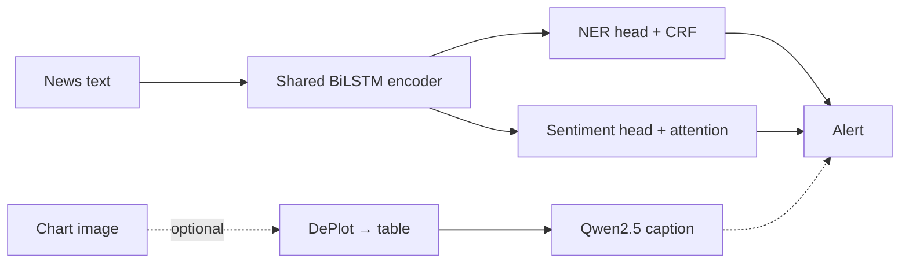

# AI Financial News Alerts

Paste a financial headline, optionally attach the chart that came with it, and get back a short alert: which companies and places are involved, whether the news reads as positive, negative or neutral, and what the chart says.

Built from scratch in PyTorch for the NLP & Deep Learning course at Comillas ICAI (January–May 2026). No pretrained NER or sentiment model is used; both are trained here.

## How it works



- **Entity recognition:** BiLSTM-CRF over GloVe embeddings, trained on FiNER-ORD (people, organisations, locations).
- **Sentiment:** BiLSTM with attention, trained on FinBERT-labelled financial sentences.
- **Joint model:** one shared encoder feeding both heads, with the loss weighted as $\mathcal{L} = \lambda_{\text{NER}}\,\mathcal{L}_{\text{NER}} + \lambda_{\text{SA}}\,\mathcal{L}_{\text{SA}}$. The best split from the ablation was $\lambda_{\text{NER}} = 0.6$, $\lambda_{\text{SA}} = 0.4$.
- **Charts (optional):** DePlot turns the image into a data table and a local Qwen2.5 model writes one sentence about it.
- **Alert:** rule-based by default, or written by an LLM with `--use-llm`.

## Results

Joint model on the held-out test split (`results/joint_vs_separate.json`):

| Task | Metric | Score |
|---|---|---|
| NER | micro-F1 | 0.687 |
| NER | F1 (PER / LOC / ORG) | 0.765 / 0.704 / 0.585 |
| Sentiment | accuracy | 0.713 |
| Sentiment | macro-F1 | 0.679 |

Sharing the encoder raised sentiment macro-F1 by about 7 points over training it on its own. The full end-to-end run over the 10 demo samples in `input/` finished without failures (`results/batch_eval_full.json`).

## Run it

CPU is enough.

```bash
git clone https://github.com/liiiaamm/ai-financial-news-alerts.git
cd ai-financial-news-alerts
python -m venv .venv && source .venv/bin/activate
pip install -r requirements.txt
```

Then follow [`Quickstart_README.md`](Quickstart_README.md) to run the pretrained checkpoints on a sample or on your own text. To rebuild the dataset and retrain everything, use [`Reproducibility_README.md`](Reproducibility_README.md).

If CUDA is detected but doesn't work on your machine:

```bash
export CUDA_VISIBLE_DEVICES=""
```

## Repository layout

| Path | What's there |
|---|---|
| `models/` | BiLSTM-CRF, attention BiLSTM, shared encoder, DePlot/Qwen captioner |
| `training/` | Training scripts for NER, sentiment and the joint model (with the λ search) |
| `pipeline.py` | End-to-end inference |
| `batch_eval.py`, `evaluate.py` | Batch runs over `input/` and model evaluation |
| `checkpoints/` | Trained weights and vocabulary |
| `results/` | Training curves, ablations and evaluation outputs |
| `input/` | 10 demo news items, each with text and chart |
| `docs/Final_Paper.pdf` | Full report |

## Team

- Liam Esgueva González
- Andrés Gil Vicente
- Jorge Carnicero Príncipe
- Jorge González Pérez
